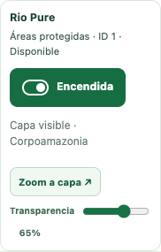
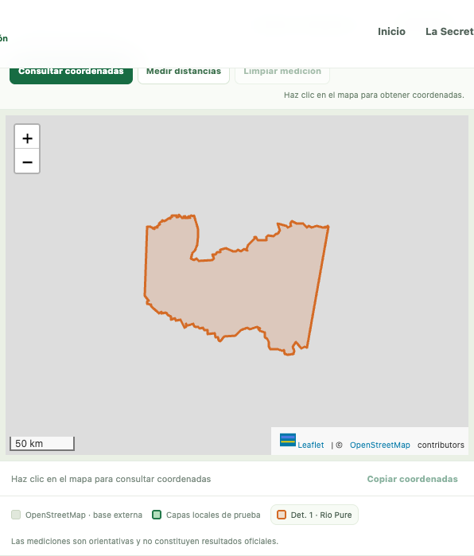
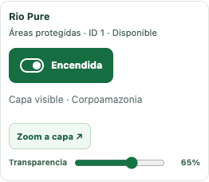
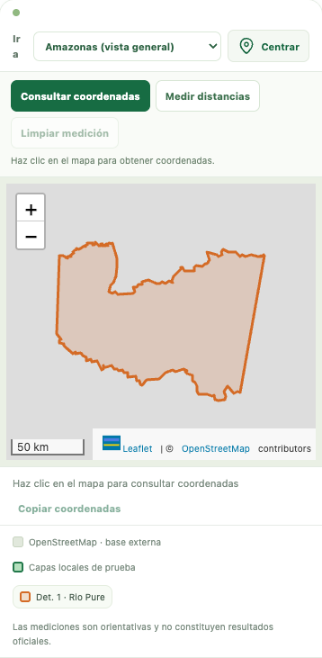
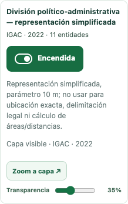
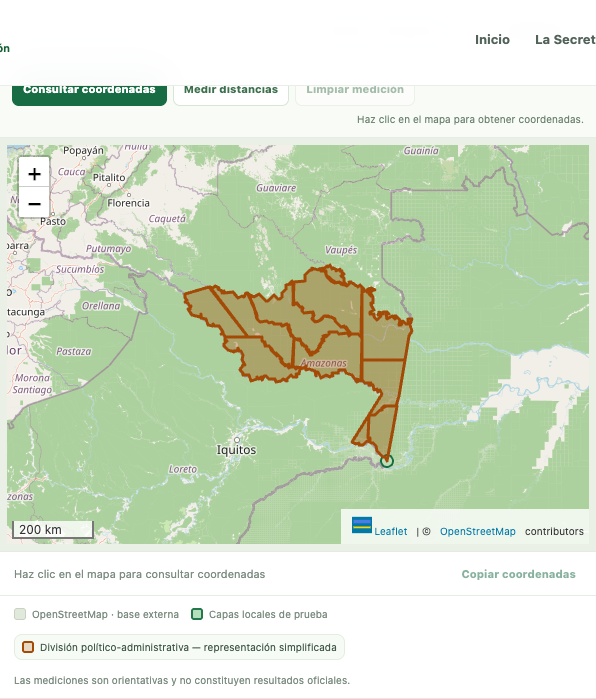
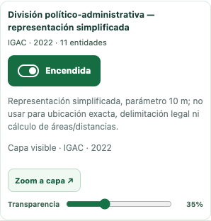
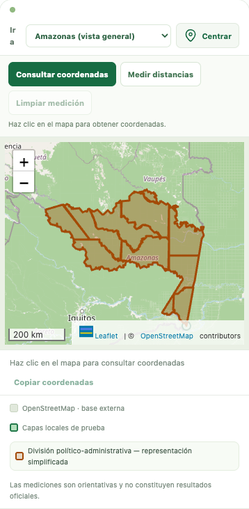

# Geovisor: interruptores y menú único (#32)

Cada una de las 33 determinantes y las 3 capas del piloto tiene un botón `role="switch"` con `aria-checked` y texto visible **Encendida / Apagada**. Las 20 determinantes disponibles y las 3 capas del piloto se pueden activar; las 13 pendientes siguen rotuladas y deshabilitadas. El catálogo vigente tiene 20/13, aunque el texto antiguo decía 18/15. No se cambia ninguna capa ni su cobertura.

Los interruptores funcionan con Espacio y Enter. El estado refleja la capa realmente visible en el mapa: durante la descarga permanece Apagada y se anuncia «Cargando», con opción de cancelar pulsando de nuevo. El estado cambia a Encendida solo tras la carga correcta; al fallar queda Apagada, muestra el error junto a esa capa y permite reintentar.

Se elimina del HTML la sección «Determinantes ambientales · Capas individuales» y `#obs19-pilot-list`. Transparencia, zoom, estado de carga y errores se conservan en cada entrada del menú temático. No se duplican las casillas: las capas temáticas tampoco reaparecen con una casilla en la lista de archivos locales. Los archivos locales y la demostración conservan sus controles; «Limpiar todas» sigue quitando las capas y sincroniza los interruptores.

Se conserva la carga bajo demanda, la cancelación, el caché del piloto y los límites existentes del visor. No se retienen los GeoJSON de determinantes en un caché adicional tras quitarlos. Un clic temprano espera a que el mapa esté listo, sin perder la opción de cancelar. Se conservan fuente/año y leyendas del piloto. No se alteran portada, animaciones, geometrías, catálogo, dependencias ni Supabase de producción.

## Pruebas

`npm test`: **131 pruebas aprobadas en 3,1 min**, incluidas todas las comprobaciones anteriores de datos, portada y accesibilidad.

Las pruebas anteriores de foco, atributos, zoom, transparencia, carga de capas y datos se migran al nuevo menú. No se eliminan sus aserciones. El recorrido de Tab de Geovisor abre todos los grupos e incluye los interruptores de las 23 capas disponibles, frente a excluir los grupos cerrados. Mantiene el conjunto exacto de controles, desplazamiento real de Tab, detección de superposición, anillo pintado y contraste de píxeles ≥3:1. Se añaden mediciones de foco encendido y apagado en escritorio y celular.

Las pruebas nuevas recorren las 23 capas con Espacio/Enter en 1280×720 y 390×844, comprobando texto, `aria-checked`, foco conservado, entidad/capa real del mapa, ausencia de duplicados y estados de pendientes. Se comprueban error de red, reintento, cancelación sin encendido tardío y sincronización al limpiar todas. Los conteos de entidades se comparan con los archivos publicados, no se inventan cuando faltan en el catálogo.

## Red lenta y vistas

[Mediciones completas](red_lenta.json). Activación desde el interruptor real, HTTP local con gzip, 1,6 Mbit/s, 150 ms de latencia y caché fría. Supabase y otros servicios simulados; solo el mapa base OpenStreetMap usa conexión externa. Una corrida por caso, orientativa; no garantiza tiempos o compresión del alojamiento. Se comprueba que cada respuesta coincida por SHA-256 con el archivo publicado y que no se descarguen geometrías antes de activar.

| Capa | Escritorio: hasta dibujo | Celular: hasta dibujo |
|---|---:|---:|
| Det. 1 · Rio Pure | 0.45 s | 0.44 s |
| Det. 17 · Humedales | 21.91 s | 21.84 s |
| División político-administrativa | 4.09 s | 4.09 s |
| Cuencas que intersectan Amazonas | 6.26 s | 6.35 s |
| Áreas protegidas | 7.17 s | 7.17 s |

La determinante 17 conserva su tamaño y tarda alrededor de 22 s con esta red; muestra su estado de descarga y puede cancelarse. No se simplifican ni modifican sus datos para reducir ese tiempo.

### Det. 1 · Rio Pure

Escritorio:





Celular:





### División político-administrativa

Escritorio:





Celular:





## Reproducir

```sh
npm test
# Para vistas y mediciones, con las herramientas ya disponibles:
python3 tests/servir_geovisor32.py
# En otra terminal, desde la raíz del repositorio:
node scripts/capturar_geovisor_32.cjs
```

El servidor solo escucha en 127.0.0.1:8878 y comprime las rutas de los catálogos públicos. No usar para publicación. No abre originales ni geodatabases. El sitio sigue siendo un prototipo y sus cálculos no son cifras oficiales. Solo Alejandro fusiona.
