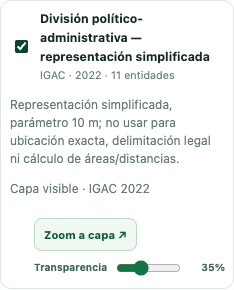
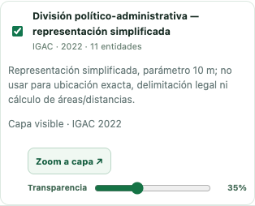
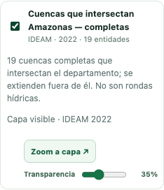
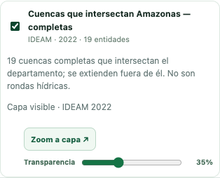
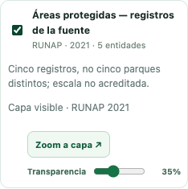
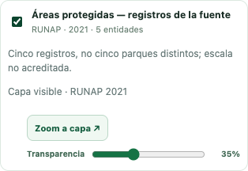

# Piloto #29: tres capas integradas bajo demanda

Alejandro autorizó publicar las fuentes IGAC, IDEAM y RUNAP y aplicar las decisiones de la revisión de Claude en #31 el 10 de noviembre de 2026. El PR se actualizó con main `bf1f72a`, que ya contiene #30 y #26. No se modifican los datos ni scripts del #26.

## Decisiones aplicadas

- **División político-administrativa:** se adopta exclusivamente la variante de 10 m evaluada, con bordes compartidos conservados. Se rotula **«representación simplificada»** en el menú y en la leyenda. No sirve para ubicación exacta, deslindes legales ni cálculo de superficies/distancias.
- **Cuencas:** se publican las 19 entidades que intersectan la unión de las 11 unidades departamentales **originales, sin simplificar**, con GEOS Intersects en el SRC nativo; incluye contactos de borde. Cada cuenca conserva geometría y atributos públicos completos, sin recorte ni simplificación. Puede extenderse fuera del departamento.
- **Áreas protegidas:** copia fiel exacta, con la misma huella del archivo revisado. Cinco registros no son cinco parques distintos.

[Paquete](../../datos/piloto_29/LEEME.md) · [catálogo](../../datos/piloto_29/catalogo_entrega.json) · [diccionario](../../datos/piloto_29/diccionario_campos.json) · [validación](../../datos/piloto_29/validacion.json) · [decisión y huellas por entidad](../../datos/piloto_29/adopcion.json) · [SHA-256](../../datos/piloto_29/SHA256SUMS).

## Entrega final y presupuesto

| Capa | Fuente / año del encargo | Entidades | MB brutos | MB gzip6 | Meta de 1 MB |
|---|---|---:|---:|---:|---|
| División político-administrativa — representación simplificada | IGAC / 2022 | 11 | 1.921 | 0.756 | Cumple |
| Cuencas que intersectan Amazonas — completas | IDEAM / 2022 | 19 | 3.212 | 1.190 | Excepción aceptada por Alejandro |
| Áreas protegidas — registros de la fuente | RUNAP / 2021 | 5 | 3.553 | 1.365 | Excepción aceptada por Alejandro |

MB = 1.000.000 bytes. Las dos excepciones permanecen explícitas en el catálogo y en las pruebas. gzip6 es medición local con Python/zlib documentados, no garantía del alojamiento; no se distribuyen solo `.gz`. El comprobador de integridad pasa; `--exigir-meta` **sigue devolviendo 2** por las dos capas de más de 1 MB, incluso estando autorizadas. CI comprueba ese resultado, sin presentar el presupuesto como cumplido.

Se mantienen 35 entidades, 50 polígonos y 51 anillos; 213.420 posiciones. Solo División reduce posiciones. Fuente y salida son válidas individualmente con GEOS. Cuencas conserva las huellas de sus entidades completas y Áreas protegidas la huella del archivo completo. No se modifican áreas, referencias normativas o valores de atributos. No se inventa escala ni vigencia de las fuentes.

La variante de División coincide exactamente con la huella del ensayo previo `coverage_vw`, parámetro 10 m. Conserva 11 polígonos/anillos y cobertura nativa sin nuevos bordes no coincidentes; Hausdorff **discreta** de bordes 9,173 m y diferencia simétrica sumada 94,564 ha. No se afirma máximo continuo exacto ni exactitud legal. El parámetro de 10 m no garantiza que todos los desplazamientos sean menores de 10 m.

Los informes [evaluacion_simplificacion.json](evaluacion_simplificacion.json), [cobertura_consulta.json](cobertura_consulta.json) y [cobertura_fiel.json](cobertura_fiel.json) son evidencia **histórica previa a esta adopción**: sus campos `adoptado:false` y las huellas/conteos fieles describen aquel ensayo, no el estado actual. La decisión vigente y las huellas finales están en `datos/piloto_29/adopcion.json`. Ningún otro ensayo se adopta.

## Integración al Geovisor

División está en **Base cartográfica**; Cuencas y Áreas protegidas en **Componente biofísico**. Fuente, año del encargo, número de entidades y restricciones se leen en cada entrada. Las casillas funcionan con teclado; al activar se descarga y muestra la capa, se ajusta el mapa y aparece su leyenda. La fuente y el año aparecen también en el detalle de estadísticas. Hay zoom y transparencia. El nombre completo de División permanece visible en la leyenda, incluido el rótulo de simplificación.

Abrir la página o desplegar categorías solo obtiene el catálogo de metadatos: **no descarga los tres GeoJSON**. Se descargan al activarlos. Se muestra el estado de carga y se puede cancelar desmarcando; un error de red permite reintentar sin duplicar capas. La misma sesión conserva en memoria las capas ya descargadas para reactivarlas sin otra descarga. Quitar/ocultar desde los controles existentes se refleja en las casillas del menú.

No se amplían los límites del importador local ni el máximo de capas simultáneas. Cuencas pesa ahora 3,21 MB brutos; desaparece el bloqueo anterior de 15 MiB para esta selección. No se utiliza Supabase de producción ni se incorporan dependencias o recursos de datos externos nuevos.

## Celular, escritorio y red lenta

[Mediciones](carga_red_lenta.json): activación desde el menú real a 1280×720 y 390×844, Chromium/Leaflet 1.9.4, 1,6 Mbit/s y latencia 150 ms, caché de capa fría. Servidor HTTP local con gzip real; cada respuesta coincide por SHA-256 con el manifiesto. OSM externo para el mapa base, Supabase y demás servicios simulados. Una corrida por caso: orientativa, no medición de producción ni garantía del alojamiento. El tiempo hasta dibujo incluye la interacción del menú y renderizado, no solo descarga.

| Capa | Escritorio: descarga → dibujo | Celular: descarga → dibujo |
|---|---:|---:|
| División político-administrativa — representación simplificada | 3.94 → 4.10 s | 3.94 → 4.07 s |
| Cuencas que intersectan Amazonas — completas | 6.11 → 6.34 s | 6.11 → 6.29 s |
| Áreas protegidas — registros de la fuente | 6.99 → 7.22 s | 6.99 → 7.17 s |

Las capturas muestran las geometrías completas, el menú con fuente/año y la leyenda. Se conserva la atribución de OpenStreetMap. Una vista general no prueba precisión normativa.

### División político-administrativa — representación simplificada

Escritorio:




Celular:




### Cuencas que intersectan Amazonas — completas

Escritorio:




Celular:




### Áreas protegidas — registros de la fuente

Escritorio:




Celular:




## Validación local

`npm test`: **125 pruebas aprobadas en 2,7 min**, incluidas 14 del piloto, sobre main actualizado. Se comprobaron también integridad del paquete y ausencia de cambios en archivos del #26 respecto de main.

## Reproducir y verificar

La preparación original sigue disponible en `scripts/preparar_piloto_29.py`. Para regenerar la adopción se necesita una copia fiel separada correspondiente al commit `eac66e4`, las copias técnicas custodiadas fuera del repositorio y el candidato de División de 10 m revisado. El adoptador exige sus hashes, verifica las copias nativas y su SRC, recalcula las 19 intersecciones y valida todas las geometrías con GEOS. No abre la geodatabase ni procesa otras capas. Ejecutar sobre el paquete ya existente conserva su diccionario y WKT.

```sh
PROJ_NETWORK=OFF python3 scripts/adoptar_piloto_29.py \
  --fiel "$PAQUETE_FIEL_SEPARADO" --interno "$COPIAS_TECNICAS" \
  --division-10m "$CANDIDATO_DIVISION_10M" --salida datos/piloto_29 \
  --gdal-library "$GDAL_LIBRARY" --geos-library "$GEOS_LIBRARY"

python3 scripts/preparar_piloto_29.py --comprobar --salida datos/piloto_29
python3 scripts/preparar_piloto_29.py --comprobar --exigir-meta --salida datos/piloto_29
npm test
```

Se requieren GDAL/GEOS con sus recursos PROJ ya disponibles solo para regenerar; no hay instalación ni descarga automática. El comprobador usa únicamente Python 3.9+ estándar; CI no recibe el original ni los candidatos privados. Las bibliotecas/versiones y el WKT nativo quedan documentados. No se presupone que un residuo numérico de transformación mida exactitud de terreno.

Para repetir vistas y medidas con Playwright disponible:

```sh
python3 tests/servir_piloto29.py
# En otra terminal, desde la raíz del repositorio:
node scripts/capturar_piloto_29.cjs
```

El servidor escucha solo en 127.0.0.1:8877 y comprime únicamente los tres GeoJSON públicos aprobados; no usar para publicación. Las pruebas cubren RFC/huellas/esquema/tratamientos autorizados, alteración de archivos, las dos excepciones de peso, carga real por menú en ambos tamaños, ausencia de descarga anticipada, controles, reintento, cancelación con teclado y conservación del foco/categorías desplegadas si el catálogo llega tarde.

La autorización del piloto no sustituye revisión futura de vigencia y licencias específicas ni vuelve oficial el prototipo. No se alteran las fuentes originales ni se procesan ubicaciones de pueblos indígenas en aislamiento voluntario. Solo Alejandro fusiona.
