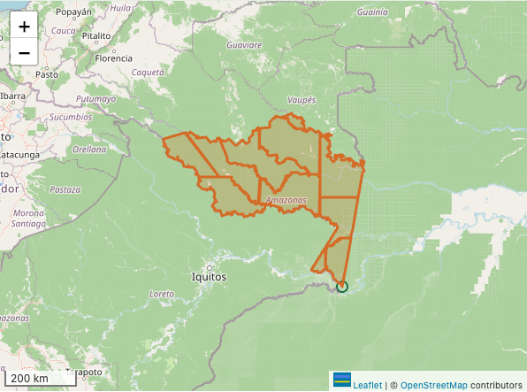
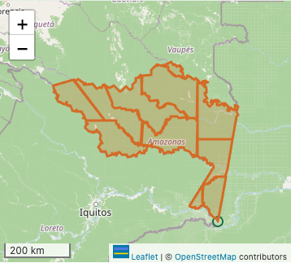
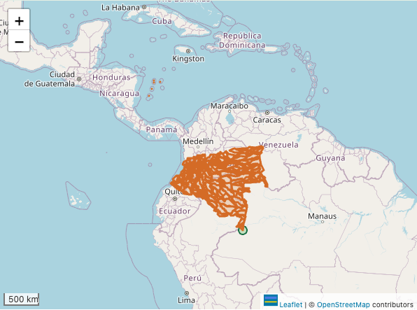
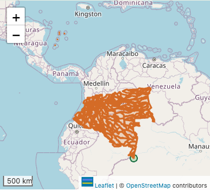
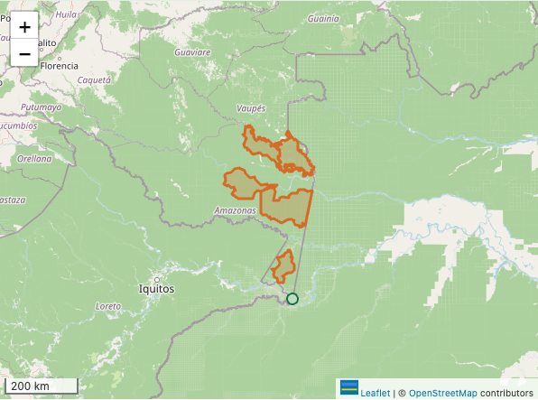
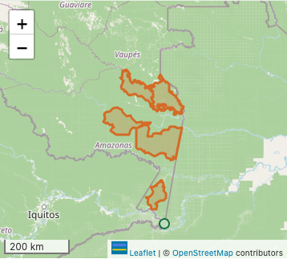

# Piloto #29: entrega fiel y evaluación no adoptada

**Estado: borrador para revisión de datos, no listo para publicación.** Se prepararon exactamente las tres capas autorizadas. Ninguna cumple todavía la meta de 1 MB transferido. El solicitante autorizó evaluar simplificación de copias, **sin adoptarla antes de revisar sus efectos**. Por ello los GeoJSON del PR son fieles y los candidatos simplificados permanecen fuera de GitHub. No se cambian los datos de #26 ni el diseño del sitio.

La rama parte de la main consultada `a938c3e`. Durante el trabajo, tanto el conector como la API directa seguían mostrando #26 y #30 abiertos; no se fusionaron ni copiaron sus cambios. La preparación de estas capas es independiente de esos PR.

## Entrega y procedencia

[Paquete de datos](../../datos/piloto_29/LEEME.md), [catálogo](../../datos/piloto_29/catalogo_entrega.json), [diccionario completo](../../datos/piloto_29/diccionario_campos.json), [control de calidad](../../datos/piloto_29/validacion.json) y [SHA256SUMS](../../datos/piloto_29/SHA256SUMS).

Fuentes/años declarados en el encargo: División (IGAC 2022), Cuencas (IDEAM 2022), Áreas protegidas (RUNAP 2021). No constituyen verificación de licencia, vigencia o aval institucional final. Se conserva la condición de prototipo; solo el responsable del proyecto decide integración/publicación.

| Capa | Entidades | Polígonos | Anillos | Posiciones, incluido cierre | MB brutos | MB gzip6 |
|---|---:|---:|---:|---:|---:|---:|
| Division_Politico_Administrativa | 11 | 11 | 11 | 163742 | 6,671 | 2,537 |
| Cuencas_Hidrograficas | 202 | 208 | 209 | 465853 | 18,484 | 6,936 |
| Sistema_Nacional_de_Areas_Protegidas | 5 | 20 | 21 | 87295 | 3,553 | 1,365 |

MB significa 1.000.000 bytes. El objetivo del encargo es transferencia, por eso se informa bruto y gzip por separado. gzip6 es una medición con Python/zlib documentados en el catálogo, no una promesa de compresión del alojamiento. Distintas implementaciones, por ejemplo Node, producen números de bytes distintos. Las huellas exactas corresponden a los archivos GeoJSON; CI comprueba también que la clasificación de peso sea correcta con su compresor. `--exigir-meta` falla con código 2: no se oculta el incumplimiento para obtener CI verde.

Los originales se abrieron solo en lectura. Se crearon copias técnicas separadas, con WKB y atributos íntegros en custodia interna. Únicamente las listas públicas del script pasan al paquete. El filtro textual de sensibilidad es defensa adicional: no garantiza ausencia de datos indirectos ni sustituye aprobación de fuentes/campos. No se derivan centroides ni se procesan otras capas.

## Equivalencia y RFC 7946

- FeatureCollection UTF-8, WGS84 longitud/latitud; sin `crs` alternativo, nulos/vacíos o coordenadas no finitas.
- Fuente y salida válidas con GEOS 3.14.1. Se conservan entidades, polígonos, anillos, posiciones y atributos públicos, incluidos los ausentes como `null`.
- Las tres fuentes son XY, con WKT nativo MAGNA CTM12. Se registran WKT, versiones de GDAL/GEOS/PROJ, huellas de geometrías nativas y procedimiento. PROJ_NETWORK=OFF: no se descargaron rejillas. No se asignó un EPSG por apariencia ni se acreditó una época geodésica.
- No se simplifica ni impone seis decimales. Se exportan los doubles con precisión de ida/vuelta y se compacta JSON. Únicamente se invierten anillos para exterior antihorario/interior horario de RFC 7946.
- Comparación inversa por posición, admitiendo la inversión de anillos: residuo máximo menor de 0,00001 unidades nativas (en estos datos, metros). Es un control numérico, **no exactitud real en terreno**.
- CI verifica huellas, esquema, orientación, conteos y RFC; la validación GEOS/origen se ejecutó localmente y queda vinculada a los archivos por SHA-256. La geodatabase no está en CI ni en este PR.

## Advertencias de contenido

- División tiene 11 unidades. `MpCategor` conserva sus códigos sin inventar su catálogo. `Restriccion` mantiene la advertencia original contra usar esta cartografía para ubicación exacta o cálculo de áreas/distancias. Los indicadores socioeconómicos agregados y superficies sin definición acreditada quedan fuera de este piloto base; no se sobrescriben en origen.
- Cuencas contiene regiones de las cinco áreas hidrográficas nacionales, no un recorte del departamento. Se preservan las 202 entidades. No se recortan cuencas al límite administrativo ni se confunden con rondas hídricas.
- Áreas protegidas contiene 5 registros, incluido «Yaigoje Apapori - Fuera»: no son cinco parques distintos. Las fechas de registro de entidades no son fecha de publicación. Valores de escala `1:1`/`Sin información` no se usan como escala acreditada. Se omiten centroides precalculados, IDs de aplicaciones, URLs y campos auxiliares de la consulta pública; no se copian sus valores a GitHub.

## Ensayos autorizados: ninguno adoptado

[Resultados reproducibles](evaluacion_simplificacion.json). Parámetros 10, 25 y 50 en metros nativos. Para División, cobertura válida: Visvalingam–Whyatt sobre bordes compartidos, permitiendo simplificar el contorno exterior. Para Cuencas/Áreas protegidas la fuente no cumple la hipótesis de cobertura (2 registros afectados en cada capa), aunque **cada geometría individual es válida**. Se ensayó Douglas–Peucker con preservación de topología por entidad, sin reparar la fuente.

La hipótesis de cobertura exige bordes coincidentes y ausencia de solapes; no es por sí sola una regla temática universal. Un solape puede ser legítimo. No se repararon las fuentes para satisfacer esta prueba. Los parámetros no deben interpretarse como límites garantizados de desplazamiento: se muestran distancias Hausdorff **discretas**, sin afirmar un máximo continuo exacto. Tampoco se ha certificado coherencia de límites entre capas distintas.

| Capa | Parámetro | MB gzip6 | Hausdorff discreta máx. (m) | Diferencia simétrica sumada (ha) | Cambio neto de área (ha) | Registros con bordes no coincidentes: origen → candidato |
|---|---:|---:|---:|---:|---:|---:|
| division_politico_administrativa | 10 | 0,756 | 9,173 | 94,564 | 1,121 | 0 → 0 |
| division_politico_administrativa | 25 | 0,493 | 32,438 | 507,043 | 7,973 | 0 → 0 |
| division_politico_administrativa | 50 | 0,314 | 43,527 | 1.627,741 | 11,913 | 0 → 0 |
| cuencas_hidrograficas | 10 | 4,493 | 10,000 | 3.142,979 | -22,173 | 2 → 182 |
| cuencas_hidrograficas | 25 | 3,412 | 31,041 | 26.016,951 | -168,064 | 2 → 193 |
| cuencas_hidrograficas | 50 | 2,422 | 62,225 | 75.777,162 | -337,190 | 2 → 193 |
| sistema_nacional_de_areas_protegidas | 10 | 0,300 | 14,678 | 707,018 | 14,348 | 2 → 4 |
| sistema_nacional_de_areas_protegidas | 25 | 0,185 | 24,986 | 1.896,407 | 21,982 | 2 → 4 |
| sistema_nacional_de_areas_protegidas | 50 | 0,122 | 51,226 | 4.159,080 | -35,856 | 2 → 4 |

En los nueve ensayos se conservan polígonos/anillos y son válidas las geometrías individuales nativas y exportadas. Eso **no basta** para aprobar una generalización: Cuencas aumenta los registros con bordes no coincidentes hasta 182/193, y Áreas protegidas de 2 a 4. No se recomiendan esas variantes para adopción. División a parámetro 10 reduce a unos 0,756 MB y conserva su cobertura, pero altera contornos; es solo candidata para revisar, no sustituye la copia fiel ni acredita límites legales. El JSON incluye cambios absolutos/relativos de superficie por entidad, no solo el neto que puede cancelar aumentos y pérdidas.

### Consulta geográfica, solo estimación

También se estimaron dos consultas sin recortar ni simplificar las geometrías de Cuencas. **No se produjo ni adoptó otra capa ni se cambió la selección autorizada**; la entrega conserva 202 entidades. [Cifras](cobertura_consulta.json).

| Consulta hipotética | Entidades | MB gzip6 |
|---|---:|---:|
| interseccion_con_division_departamental | 19 | 1,190 |
| atributo_NOM_AH_Amazonas | 57 | 2,824 |

Aun la consulta de cuencas que intersectan las unidades departamentales supera la meta sin generalizar. Filtrar por `NOM_AH=Amazonas` no equivale a recortar al departamento. Cualquier cambio de cobertura pública requiere decisión expresa; no se aplicó.

## Geovisor y conexión lenta

[Mediciones](carga_red_lenta.json): Chromium/Leaflet 1.9.4, 1280×720 y 390×844; 1,6 Mbit/s, 150 ms, caché de la capa deshabilitada, transferencia gzip real por servidor local. Supabase y otros servicios simulados; teselas OpenStreetMap externas. Una corrida por caso, orientativa, no benchmark de producción. El hash de cada respuesta coincide con el GeoJSON de entrega.

Se usó la misma API de carga que emplea el catálogo actual; **no se añadieron entradas al menú público**. La importación local vigente rechaza Cuencas porque sus 18,48 MB brutos exceden 15 MiB. Esa restricción no se amplió ni se ocultó: se prueba el rechazo. La previsualización técnica por API no debe presentarse como integración pública terminada.

| Capa | Escritorio: descarga → dibujo | Celular: descarga → dibujo |
|---|---:|---:|
| Division_Politico_Administrativa | 12,88 → 13,03 s | 12,87 → 13,01 s |
| Cuencas_Hidrograficas | 34,93 → 35,17 s | 34,93 → 35,17 s |
| Sistema_Nacional_de_Areas_Protegidas | 7,00 → 7,09 s | 7,00 → 7,08 s |

Capturas del mapa real del geovisor, conservando la atribución visible de OpenStreetMap. La semejanza visual a escala general no valida precisión normativa ni autoriza generalización.

### Division_Politico_Administrativa

Escritorio:



Celular:



### Cuencas_Hidrograficas

Escritorio:



Celular:



### Sistema_Nacional_de_Areas_Protegidas

Escritorio:



Celular:



## Reproducir y verificar

Se requiere Python 3.9+ para verificar. Para preparar/evaluar se usan las bibliotecas GDAL/GEOS ya disponibles y sus recursos PROJ. No hay instalador ni descargas automáticas. Las variables siguientes son parámetros locales, no deben copiarse con valores privados a GitHub.

```sh
python3 scripts/preparar_piloto_29.py \
  --geodatabase "$FUENTE_AUTORIZADA" \
  --interno "$CUSTODIA_INTERNA_FUERA_DEL_REPO" \
  --salida datos/piloto_29 --version 20261110 \
  --gdal-library "$GDAL_LIBRARY" --geos-library "$GEOS_LIBRARY" \
  --gdal-data "$GDAL_DATA" --proj-data "$PROJ_DATA"

python3 scripts/preparar_piloto_29.py --comprobar --salida datos/piloto_29
python3 scripts/preparar_piloto_29.py --comprobar --exigir-meta --salida datos/piloto_29

PROJ_NETWORK=OFF python3 scripts/evaluar_piloto_29.py \
  --interno "$CUSTODIA_INTERNA_FUERA_DEL_REPO" \
  --candidatos "$CANDIDATOS_INTERNOS_FUERA_DEL_REPO" \
  --informe docs/piloto_29/evaluacion_simplificacion.json \
  --gdal-library "$GDAL_LIBRARY" --geos-library "$GEOS_LIBRARY"
```

El preparador solo lee las tres capas de la lista, conserva copias técnicas fuera del repositorio y genera el paquete desde esas copias. Rechaza fuente nula/vacía/Z/M/inválida, esquemas/conteos inesperados y marcadores de sensibilidad. No corrige automáticamente. La evaluación no lee ni modifica la geodatabase; trabaja con esas copias y exige que sus candidatos se guarden fuera del repositorio. Las huellas permiten reproducir con las mismas versiones; no son aval de licencia o contenido.

Para repetir las seis capturas y la medición local, con Playwright ya disponible:

```sh
python3 tests/servir_piloto29.py
# En otra terminal, desde la raíz del repositorio:
node scripts/capturar_piloto_29.cjs
```

El servidor solo escucha en 127.0.0.1:8877 y sirve los tres GeoJSON públicos con gzip y sin caché; no abre el original. La captura intercepta la configuración/servicios de Supabase y permite únicamente las teselas de OpenStreetMap como recurso externo real. No usar este servidor para publicación.

## Pendientes para publicación

1. Revisión independiente de fidelidad, fuente, autorización de publicación y significado de atributos.
2. Decidir si se adopta alguna generalización o se sigue evaluando otra estrategia; ninguna está aprobada. No prometer que las tres capas ya pesan menos de 1 MB.
3. Resolver estrategia de cobertura/peso de Cuencas y su carga pública; no ampliar límites del importador solo para pasar la prueba.
4. Integración al catálogo/menú en otro cambio acordado, con pruebas de interacción, leyendas, transparencia y descarga bajo demanda. Solo el responsable del proyecto fusiona/publica.

Referencias: [RFC 7946](https://datatracker.ietf.org/doc/html/rfc7946), [GDAL GeoJSON](https://gdal.org/en/stable/drivers/vector/geojson.html), [API de coberturas GEOS](https://libgeos.org/doxygen/geos__c_8h.html).
